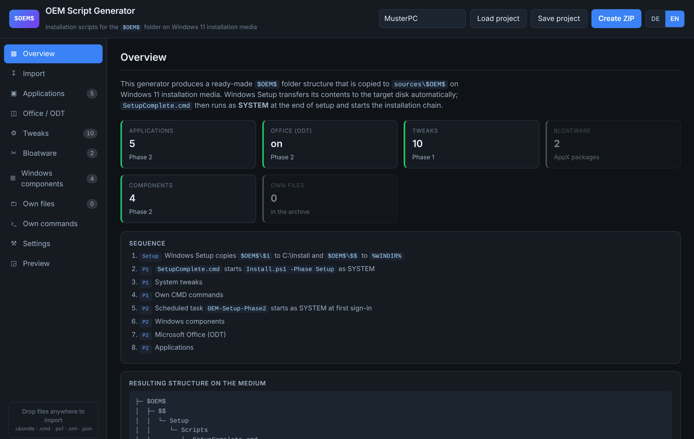
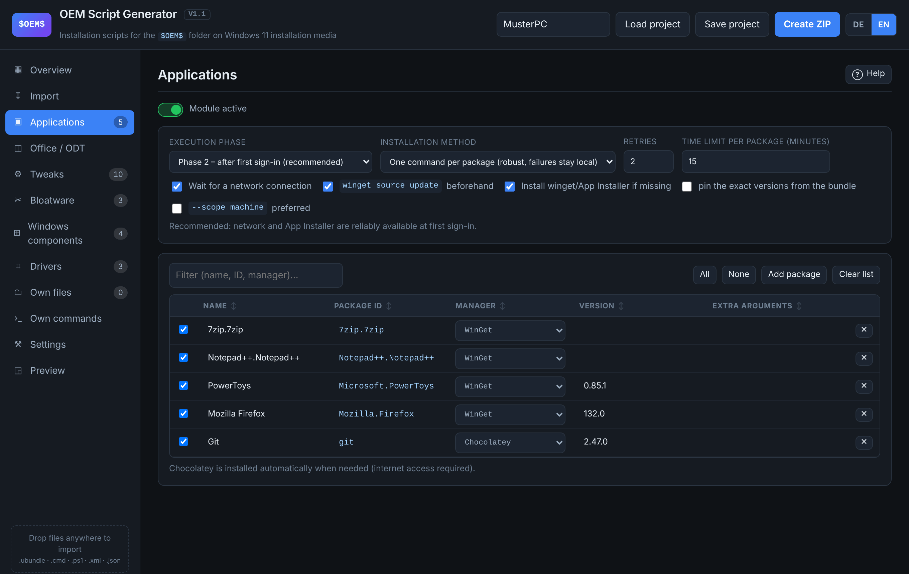
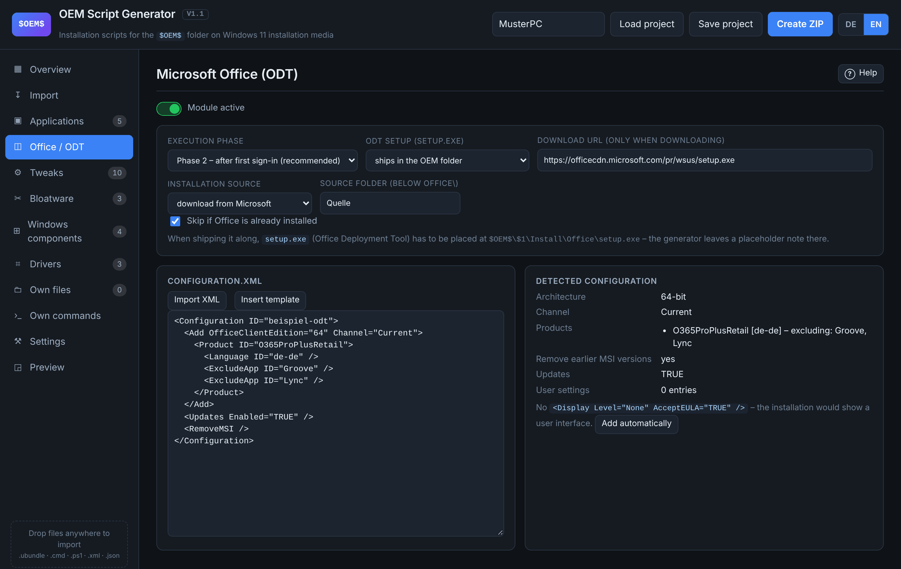
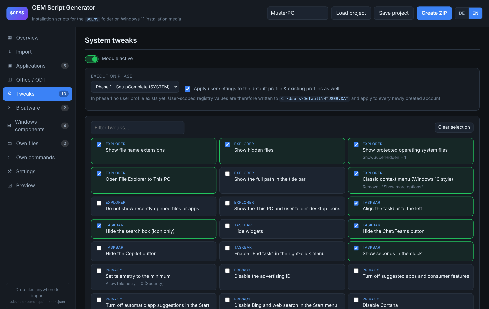
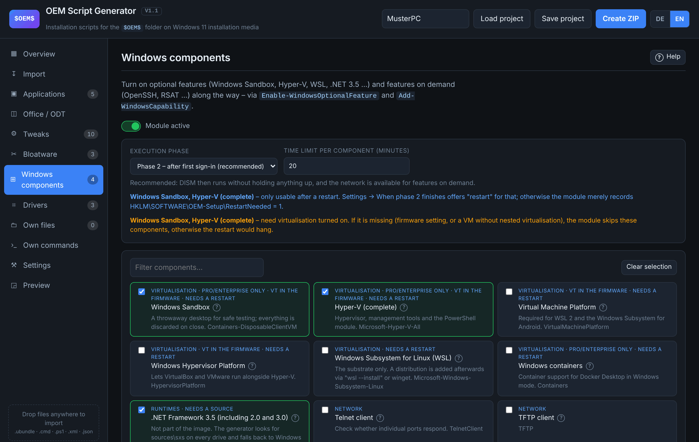
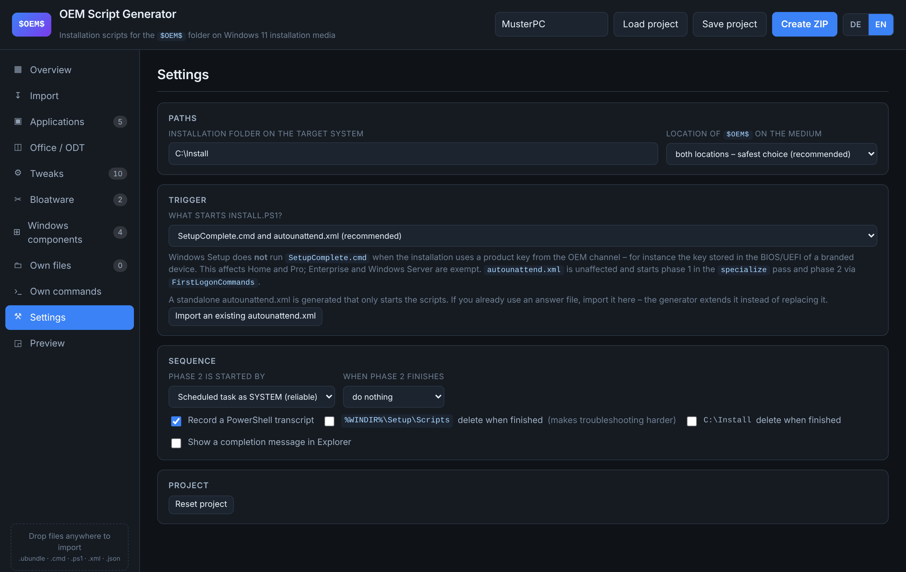
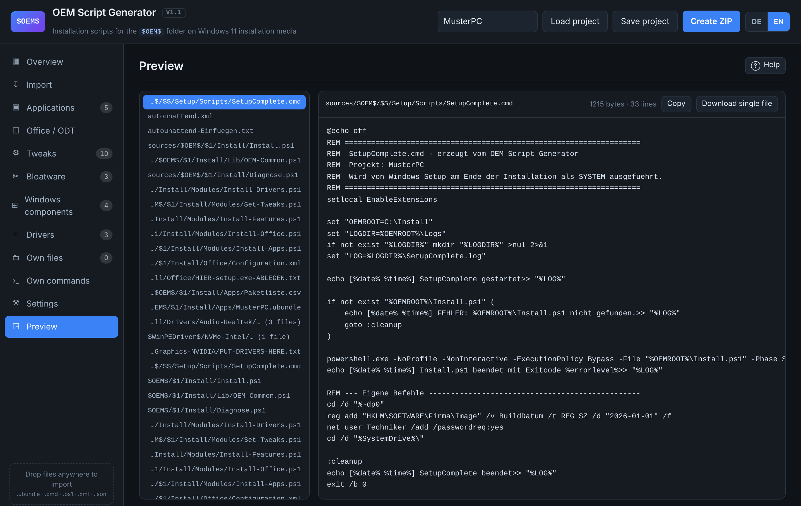
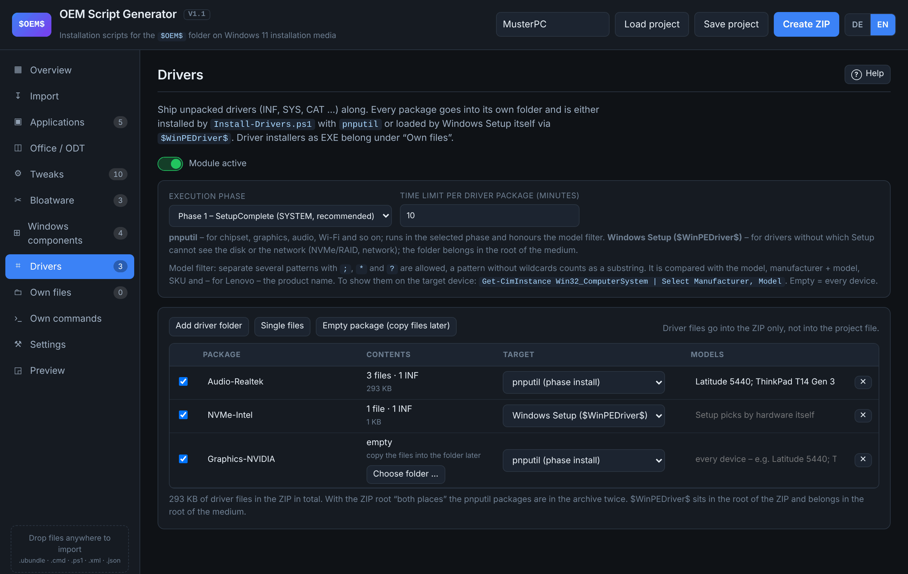
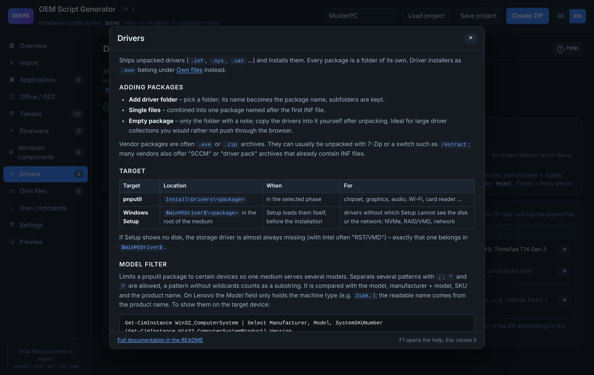

# OEM Script Generator

*[Deutsche Fassung](README.md) · English version*

Web interface for generating installation scripts for the `$OEM$` folder of a
Windows 11 installation medium. You configure everything in the browser and get a
ZIP with the finished folder structure, ready to copy onto the ISO or the USB stick.

Runs entirely locally: no server component, no external libraries, no build step.
Opening `index.html` in a browser is enough (`file://` works too).

The interface is bilingual — German and English. The switch sits in the header
(**DE** / **EN**); on first start the browser language decides. The language also
determines whether the generated archive contains `LIESMICH.txt` or `README.txt`.

## Screenshots



| | |
|---|---|
|  |  |
| **Applications** – packages from bundles and scripts, each with manager and version | **Office / ODT** – analyse and check Configuration.xml |
|  |  |
| **Tweaks** – settings with phase and network needs | **Windows components** – with help link and virtualisation check |
|  |  |
| **Settings** – trigger, phase 2, completion | **Preview** – every generated file before export |
|  |  |
| **Drivers** – packages for pnputil or Windows Setup, with a model filter | **Help** – a detailed description of every page, also via F1 |

## Download

The ready-made package is under [Releases](https://github.com/dmatrix68-boop/OEM-script-gen/releases):
unpack the ZIP and open `index.html`. Inside the package the screenshots are links only.

## Features

* **Import of existing scripts** – `SetupComplete.cmd`/`.bat` is analysed:
  `winget install` calls become packages, ODT calls are recognised, and everything
  else is preserved unchanged as "custom commands". Also importable: ODT
  `Configuration.xml`, PowerShell scripts, arbitrary binaries.
* **UniGetUI import** – `.ubundle` (JSON, XML, YAML) and winget `export` files.
  Non-winget managers (Chocolatey, Scoop, npm, pip, Cargo, .NET tool) are taken
  over and installed appropriately; Chocolatey is installed on demand. Export
  produces a `.ubundle` again that UniGetUI can read back. The package list can
  be sorted by clicking a column header; the installation order stays as it is.
* **Microsoft Office (ODT)** – import or edit Configuration.xml, with an analysis
  (products, languages, channel) and a check for unattended installation. Runs in
  phase 2 by default, because the Deployment Tool downloads the installation files
  from the network.
* **System tweaks** – around 35 settings for Explorer, taskbar, privacy, system and
  network. User-scoped values are written to `C:\Users\Default\NTUSER.DAT` in phase 1
  and therefore apply to new accounts. Settings that need a running network or
  service stack are automatically deferred to phase 2 (see below).
* **Bloatware** – pick pre-installed AppX packages, provisioning removal included.
* **Windows components** – turn on Windows Sandbox, Hyper-V, WSL, .NET 3.5, OpenSSH,
  RSAT and other features along the way (see below).
* **Drivers** – install unpacked drivers with `pnputil` or load them in Windows
  Setup already via `$WinPEDriver$`, optionally per device model (see below).
* **Custom files** – ship installers and scripts, either to `Install\Files` (where
  they are executed) or next to `SetupComplete.cmd` in `Setup\Scripts` (reachable
  via `%~dp0`).
* **autounattend.xml** – generated as a trigger or, if you already use an answer
  file, imported and **extended rather than replaced**: the calls are inserted into
  the existing blocks with a continuing `<Order>`.
* **Diagnose.ps1** – ships inside the generated package and answers, after the
  installation, why nothing ran.
* **Help on every page** – the *Help* button in the page header (or <kbd>F1</kbd>)
  opens a detailed description of every option on the page, in German or
  English, with cross references between the topics.
* **Preview** of every generated file, a **project file** to save and continue
  working, ZIP export (ZIP64 from 4 GB on) or (Chrome, Edge) **export straight into a
  folder** or onto the USB stick. Chrome and Edge ask for the target with a "Save as"
  dialog; Firefox and Safari download the file.

## Two-phase model

| Phase | Trigger | Context | Suitable for |
|-------|---------|---------|--------------|
| 1 | `SetupComplete.cmd` at the end of setup | SYSTEM, before the first logon | registry, bloatware, Office (ODT) |
| 2 | Scheduled task or `RunOnce` at the first logon | SYSTEM resp. first user | winget packages, anything needing the network |

## Triggers – why `SetupComplete.cmd` alone is not enough

Windows Setup does **not** run `SetupComplete.cmd` when the installation uses a
product key from the OEM channel – for instance the key stored in the BIOS/UEFI of
a branded device. This affects the client editions (Home, Pro); Enterprise and
Windows Server are exempt. The setup log
`C:\Windows\Panther\setupact.log` then says, in effect:

```
Client OS edition and OEM license detected and no enterprise edition detected,
will not run SetupComplete.cmd
```

The generator therefore offers three triggers, both together by default:

| Trigger | Phase 1 | Phase 2 | affected by the OEM block |
|---|---|---|---|
| `SetupComplete.cmd` | at the end of setup | scheduled task / RunOnce | **yes** |
| `autounattend.xml` | `specialize` pass | `FirstLogonCommands` | no |

Running more than once does no harm: `Install.ps1` records every completed phase
under `HKLM\SOFTWARE\OEM-Setup` and skips it on the next call; `-Force` forces the
repetition.

Concurrent runs are guarded twice over. A named mutex alone is not enough: if
SYSTEM creates it with default permissions, a run in the user context fails to open
it with "access denied" and would run in parallel unchecked. The mutex is therefore
created with an access rule for everyone, and in addition `Install.ps1` keeps a run
marker with the process ID in the registry, which every context can read. If the
autounattend.xml already covers phase 2 via `FirstLogonCommands`, the scheduled task
only starts after a 15-minute delay — as a fallback, not as a second concurrent run.

### Why some tweaks only run in phase 2

In the `specialize` pass the network stack is not yet initialised. Cmdlets such as
`Get-NetConnectionProfile`, `Enable-NetFirewallRule` or
`Disable-WindowsOptionalFeature` may wait there indefinitely — and because Windows
Setup waits for the command to finish, **the entire installation comes to a halt**.
`-ErrorAction SilentlyContinue` does not help against that: it suppresses errors,
not blocking.

The same deferral applies to settings that need an existing user account — such as
"correct the display name of the user account". In the account settings Windows shows
the full name (`FullName`) and only falls back to the account name; shortly after an
installation a placeholder such as `USER` is sometimes shown there. **As a rule
Windows picks up the correct name by itself**, so this tweak is not a default case —
it is meant for installations where the placeholder sticks. It sets `FullName` to the
account name, and only where there really is a placeholder: self-assigned names,
disabled accounts and system accounts are left untouched.

The affected entries are marked `deferPs` in the catalog (`deferReason`
distinguishes network from account dependency). If the tweak module is set to
phase 1, the generator derives a second module `Set-Tweaks-Spaet.ps1` from it that
runs in phase 2; the registry parts of the same tweak stay in phase 1. Each of
these calls additionally runs through `Invoke-WithTimeout` with its own time limit,
is cancelled when that expires and is logged — so a hanging cmdlet can no longer
block the sequence.

The block runs in a runspace of its own and does not know the functions from
`OEM-Common.ps1`; `deferPs` tweaks may therefore only use native cmdlets.

## Where does `$OEM$` belong?

That depends on the answer file – putting it in the wrong place is the most common
reason why nothing gets copied at all:

| Answer file | Location |
|---|---|
| `<UseConfigurationSet>true</UseConfigurationSet>` (set by the generator) | `<medium>\$OEM$\…` (root directory) |
| no answer file | `<medium>\sources\$OEM$\…` |
| answer file with `UseConfigurationSet=false` | on current Windows 11 builds possibly **not copied at all** |

With `UseConfigurationSet=true` Setup looks for the configuration set **next to the
answer file**. Without this value Windows Setup (Windows 11, build 26300) did not
copy `$OEM$` at all in a test – neither from `sources\` nor from the root; there was
no installation folder and no phase 2. The generator therefore writes
`UseConfigurationSet=true` into the generated and into an imported answer file
(*Settings → Trigger*, can be turned off) and sets the location to "both places" –
Setup only evaluates the matching one, the other folder is ignored.

With `true` Setup copies the folder of the answer file to `C:\Windows\ConfigSetRoot`.
On a normal installation medium that is harmless; on multi-boot sticks such as
Ventoy it can get very large.

### Office needs a network

The Office Deployment Tool downloads the installation files from Microsoft — even
when `setup.exe` is shipped along; the archive only contains the tool, not Office
itself. In phase 1 (`specialize`) there is no network connection available yet,
exactly as with the network tweaks above.

The Office module is therefore set to phase 2. Without a network and without a local
source it aborts with an explanatory message instead of running into nothing.

#### Offline installation from a shipped source

For phase 1 — or for machines without internet access — set the installation source
under *Office → installation source* to **shipped locally**. The generator then
writes `SourcePath` into the `Configuration.xml` and creates in the package:

```
Office/
├─ setup.exe                      (ODT, add it yourself)
├─ Configuration.xml              SourcePath=C:\Install\Office\Quelle
├─ Download-Quelle.ps1            creates the source
└─ Quelle/                        this is where Office\Data\… goes
```

The source itself does **not** end up in the ZIP — pushing several gigabytes through
the browser is not practical. Instead, after extracting, run this once on the
staging machine:

```powershell
powershell -ExecutionPolicy Bypass -File Office\Download-Quelle.ps1
```

The script reads the `Configuration.xml`, downloads exactly the products and
languages configured in it via `setup.exe /download` into the source folder and
reports the resulting size at the end. The filled folder then goes onto the medium.

The Deployment Tool's exit code is not the only verdict: after the installation
`Install-Office.ps1` reads
`HKLM\SOFTWARE\Microsoft\Office\ClickToRun\Configuration` and treats a deviating
exit code as a warning when Office is there afterwards. If it is not, the module
aborts with an exception, so that the summary at the end of the run does not
report `OK` regardless.

`Install-Office.ps1` checks at runtime whether `Office\Data` really exists under
`SourcePath`. If the source is missing — because it was not copied along, for
instance — it removes `SourcePath` from a working copy of the answer file and
continues installing online instead of failing on an empty folder.

### Windows components

Optional features (`Enable-WindowsOptionalFeature`) and features on demand
(`Add-WindowsCapability`) can be turned on along the way – Windows Sandbox,
Hyper-V, WSL, containers, .NET 3.5, Telnet, IIS, ProjFS, OpenSSH and the RSAT
tools. The **?** next to each component opens the matching Microsoft help page
in German or English, following the interface language. The module defaults to
phase 2 and checks before every call:

| Check | Behaviour |
|---|---|
| already enabled or installed | skipped, no DISM call |
| edition (`EditionID` starts with `Core`) | Sandbox, Hyper-V and containers are dropped on Home |
| virtualisation (VT-x/AMD-V, firmware, SLAT – also inside a VM with nested virtualisation; alternatively VBS or Hyper-V already active) | Sandbox, Hyper-V, Virtual Machine Platform and Hypervisor Platform are skipped without virtualisation – otherwise the restart would hang. The raw values go to the log |
| network | features on demand are skipped without a connection |

Every call runs through `Invoke-WithTimeout` with its own time limit (20 minutes
by default) – so a hanging DISM cannot block the sequence. That counts double if
the module does run in phase 1, because Windows Setup waits for every call there.

`.NET Framework 3.5` is not part of the installed image. The module looks for
`sources\sxs` on every drive – if the installation medium is still in the
machine it installs from there, otherwise via Windows Update. Features on demand
(OpenSSH, RSAT) always come from Windows Update; a WSUS policy that does not
allow features on demand makes them fail.

Components that need a restart set
`HKLM\SOFTWARE\OEM-Setup\RestartNeeded = 1`. *Settings → When phase 2 finishes →
restart* takes care of that by itself.

### Drivers

Unpacked drivers (INF, SYS, CAT …) are shipped as packages – one folder per
package. Add them with **Add driver folder** (the folder name becomes the package
name), as single files, or as an **empty package** whose files you copy to the
medium yourself later. Empty packages suit large driver collections you would
rather not push through the browser.

| Target | Location | When | Suited for |
|---|---|---|---|
| **pnputil** | `$OEM$\$1\Install\Drivers\<package>` | in the selected phase (default: phase 1) | chipset, graphics, audio, Wi-Fi … |
| **Windows Setup** | `$WinPEDriver$\<package>` in the root of the medium | Setup loads them itself, before the installation | NVMe/RAID, network – anything Setup cannot do without |

`Install-Drivers.ps1` calls
`pnputil /add-driver <package>\*.inf /subdirs /install` per package, with its own
time limit. Exit code 3010 sets `RestartNeeded`, 259 means "in the driver store,
but no device took it" – both count as success.

**Model filter:** a package can be limited to certain devices, so one medium
serves several models. Separate several patterns with `;`, `*` and `?` are
allowed, a pattern without wildcards counts as a substring. It is compared with
the model, manufacturer + model, SKU and – for Lenovo, where `Model` only holds
the machine type – the product name from `Win32_ComputerSystemProduct`. The
detected values are written to the log. To show them on the target device:

```powershell
Get-CimInstance Win32_ComputerSystem | Select Manufacturer, Model, SystemSKUNumber
```

Driver files go into the ZIP only, not into the project file: after loading a
project the packages are back, but empty, showing the folder they last came
from. They cannot be attached automatically – when a web page reads a
remembered folder, Chrome leaves out every file type it rates as dangerous, the
DLLs of all things. Files under *Own files*, on the other hand, are remembered
by Chrome/Edge and attached again right away when the project is loaded; if
Chrome needs permission again, one click on **Attach sources** is enough (same
browser profile only). With the ZIP root "both places" the
pnputil packages are in the archive twice. Driver installers as EXE still belong
under *Own files* in the interface.

### winget needs a user context

`winget.exe` is part of an MSIX package. It is reachable through the app execution
alias at `%LOCALAPPDATA%\Microsoft\WindowsApps\winget.exe` — and that exists **per
user only**. Calling the file directly from `C:\Program Files\WindowsApps\…`
instead, as seems natural under SYSTEM, makes it abort with `0xC0000135`
(`-1073741515`, DLL not found), because the MSIX dependencies are not resolved.

Measured on a run with 33 packages: as SYSTEM 3 succeeded, in the user context 33.

Which winget exit codes count as success follows `AppInstallerErrors.h` from
winget-cli: besides `0` and the reboot codes `3010` and `1641` those are
`0x8A150061` (package already installed) and `0x8A15002B` (no applicable upgrade).
`0x8A150014` means *no package found* and explicitly does **not** count — otherwise a
misspelled package ID would pass as successfully installed. For the most common
error codes the module writes a plain-language line into the log.

For the same reason `Install-Apps.ps1` calls the package managers **directly**
(`& $exe $args`) and not via `Start-Process`: the alias kicks off the actual
operation and exits immediately, so `Start-Process`/`WaitForExit` only waits on the
stub, returns an empty exit code and reports a package that is currently installing
as failed. The necessary time limit comes instead from running the call in a
background job — there `$LASTEXITCODE` is preserved. For applications, phase 2
therefore has to run in the user context — via `FirstLogonCommands` of the
autounattend.xml or via `RunOnce`. `Resolve-Winget` checks every candidate up front
with `--version` and aborts with an explanatory message instead of letting every
package fail individually.

Background on the phases: in phase 1 `winget` is only usable to a limited extent –
the App Installer is an MSIX package that is not in the search path under SYSTEM
(the generator resolves the path under `Program Files\WindowsApps` itself), and
packages that install per user only fail without a user profile. That is why phase 2
is preselected for applications.

## Generated structure

```
autounattend.xml                            → root directory of the medium
sources/$OEM$/  or  $OEM$/
├── $$/Setup/Scripts/SetupComplete.cmd     → %WINDIR%\Setup\Scripts
└── $1/Install/                            → C:\Install
    ├── Install.ps1                        control script (-Phase Setup|FirstLogon|Manual)
    ├── Diagnose.ps1                       troubleshooting after the installation
    ├── Lib/OEM-Common.ps1                 logging, registry helpers, winget resolution
    ├── Modules/                            Set-Tweaks, Remove-Bloatware,
    │                                       Install-Features, Install-Office,
    │                                       Install-Apps, Install-Files-P1/P2,
    │                                       Invoke-Custom
    ├── Office/Configuration.xml
    ├── Apps/  Paketliste.csv, packages.json, *.ubundle
    └── Logs/                              logs and transcripts
```

## Usage

1. Open `index.html` (Chrome, Edge or Firefox).
2. Drag and drop existing scripts or the UniGetUI bundle.
3. Configure the modules, check the preview, **generate the ZIP**.
4. Copy the contents of the ZIP into the root directory of the installation medium so
   that `<medium>\sources\$OEM$\...` results. The `README.txt` contained in the ZIP
   (`LIESMICH.txt` in German) lists what is still missing (e.g. `setup.exe` of the
   Office Deployment Tool).

Instead of 3. and 4., Chrome and Edge also offer **Export to folder**: pick the root of
the USB stick and you are done – no unpacking, installers and drivers are copied from
disk as a stream. Existing `$OEM$`, `sources\$OEM$` and `$WinPEDriver$` folders in the target
are emptied first after a confirmation – otherwise removed drivers, for example, would
stay behind. Everything else on the stick stays untouched; an existing
`autounattend.xml` that was not imported would be replaced, which the confirmation
points out. File types Chrome does not write to folders (above all `.dll`, plus `.ini`,
`.cfg`, `.manifest`) end up on the stick as `*.oemrename` and in `Umbenennen.txt`;
`Install.ps1` renames them back before the first module. That does not work for drivers
under `$WinPEDriver$` – use the ZIP for those.

Large packages fit into the ZIP as well: from 4 GB or 65,535 files on the generator
writes **ZIP64** automatically, which Windows Explorer (Windows 10 and later) and 7-Zip
unpack. Files over 128 MB go in uncompressed – drivers and installers are usually
compressed already – but the browser reads them straight from disk instead of collecting
them in memory (tested: a 5.2 GB archive with less than 90 MB of memory).

### The installation has to be booted from the medium

Windows Setup only evaluates `$OEM$` and `autounattend.xml` when you **boot** from
the installation medium. If you start `setup.exe` from within a running Windows,
Setup runs in the downlevel phase (working folder `C:\$WINDOWS.~BT`) and ignores
both. The setup logs of that phase are located under
`C:\$WINDOWS.~BT\Sources\Panther\` – `Diagnose.ps1` searches them as well.

### When nothing happened

On the installed system, in an elevated PowerShell:

```powershell
powershell -ExecutionPolicy Bypass -File C:\Install\Diagnose.ps1
```

If the package sits somewhere else — still on the medium, say — the script finds its
own folder by itself; `-InstallRoot <path>` lets you specify it as well.

The script checks files, execution markers, the scheduled task and the logs,
evaluates `setupact.log` and reports explicitly when Setup refused
`SetupComplete.cmd` because of the OEM licence channel, or when `$OEM$` was in the
wrong place.

With `-Export` it packs the relevant parts into a ZIP of typically a few kilobytes –
the matching lines from every `setupact.log` location found, its own logs and the
system state. That is what you need in order to pass it on; whole setup folders are
not necessary for that:

```powershell
powershell -ExecutionPolicy Bypass -File C:\Install\Diagnose.ps1 -Export
```

### Testing without a reinstallation

On a test system, in an elevated PowerShell:

```powershell
powershell -ExecutionPolicy Bypass -File C:\Install\Install.ps1 -Phase Manual
powershell -ExecutionPolicy Bypass -File C:\Install\Install.ps1 -Phase Manual -Only Set-Tweaks.ps1
```

## Notes

* The generated `.ps1` files are written with a UTF-8 BOM so that Windows
  PowerShell 5.1 reads umlauts correctly.
* `$OEM$` is only evaluated when setup is started from this medium.
* If phase 1 runs via the `specialize` pass, every module delays setup, because
  Windows waits for the command to finish. Long runners such as the Office
  installation are therefore better placed in phase 2.
* When a project is saved, shipped binaries are **not** included in the project file –
  they have to be added again after loading.
* The generated PowerShell scripts and their log output are German regardless of the
  interface language; only the documentation in the archive follows the switch.

## Development

The PowerShell scripts are produced inside JavaScript template literals. There
JavaScript swallows backslash sequences it does not know as an escape: `'\s+'`
becomes `'s+'`, `'\|'` becomes `'|'` — the generated code then silently contains a
different pattern. Among other things that produced a `-split` that never split
anything, and a `-replace` that replaced every "s" with a space. Inside a template
literal such sequences therefore belong doubled (`\\s+`). This checks for it:

```bash
node tools/check-escapes.js
```

On bilingualism: interface strings carry `data-i18n`, catalog and runtime
strings go through `T()`/`F()` with the German version as the key. A translated
element must not contain an element with an `id` – `I18n.apply()` rewrites its
contents wholesale and would overwrite counters or paths set there. This checks
for it:

```bash
node tools/check-i18n.js
```

Processes are started through `ProcessStartInfo`, not through
`Start-Process -PassThru`: that process object returns an empty `ExitCode` after
`WaitForExit()`, because PowerShell does not keep the handle open. It made the
Office Deployment Tool look like a failure despite a successful installation.
Output is read asynchronously – waiting first and reading afterwards hangs as
soon as the program writes more than fits in the buffer.

## Project layout

```
index.html        interface
css/app.css       layout
js/version.js     version number (the only place)
js/help.js        help texts per page (German/English)
js/i18n.js        German/English dictionary and language switching
js/zip.js         ZIP writer (deflate via CompressionStream, otherwise "stored")
js/catalog.js     catalog of tweaks, bloatware and Windows components, package managers
js/importers.js   parsers for bundles, SetupComplete.cmd and ODT XML
js/templates.js   generation of every script
js/app.js         state, interface, import/export
samples/          sample files for testing the import function
tools/            check-escapes.js – checks the template literals for swallowed escapes
                  check-i18n.js    – checks the dictionary against the interface
                  build-release.js – builds the release package
docs/screenshots/ images for the README (not in the release package)
docs/releases/    release notes per version
```

### Creating a release

A `v*` tag starts the workflow `.github/workflows/release.yml`. It runs both
checks, builds the package `dist/OEM-Script-Generator-<tag>.zip` with
`node tools/build-release.js <tag>` and creates the GitHub release. The release
notes come from `docs/releases/<tag>.md`. Inside the package the script replaces
the embedded screenshots in both READMEs with links to the repository at the
same tag. Adjust the version number in `js/version.js` first – the build script
stops if it does not match the tag.

```bash
git tag v1.1 && git push origin v1.1
```
