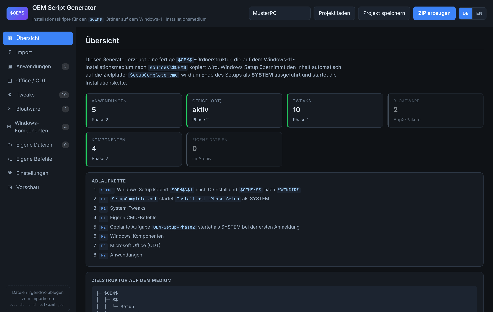
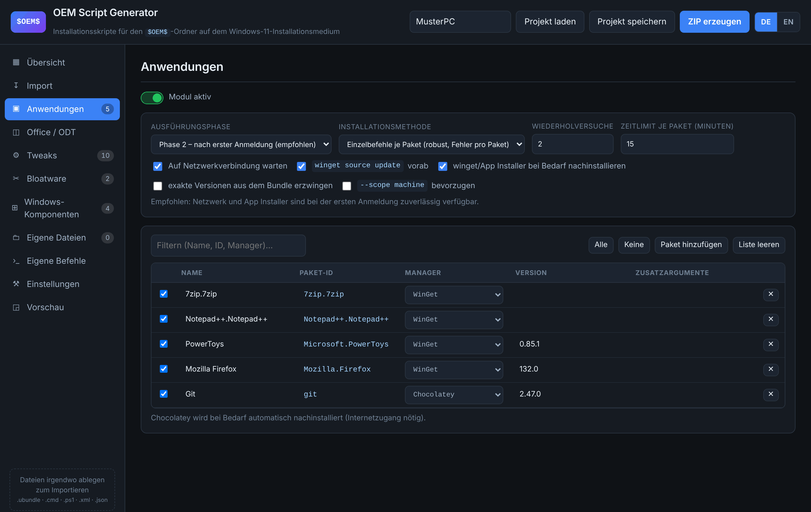
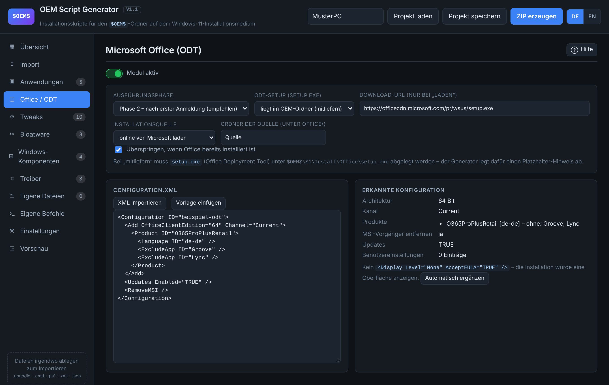
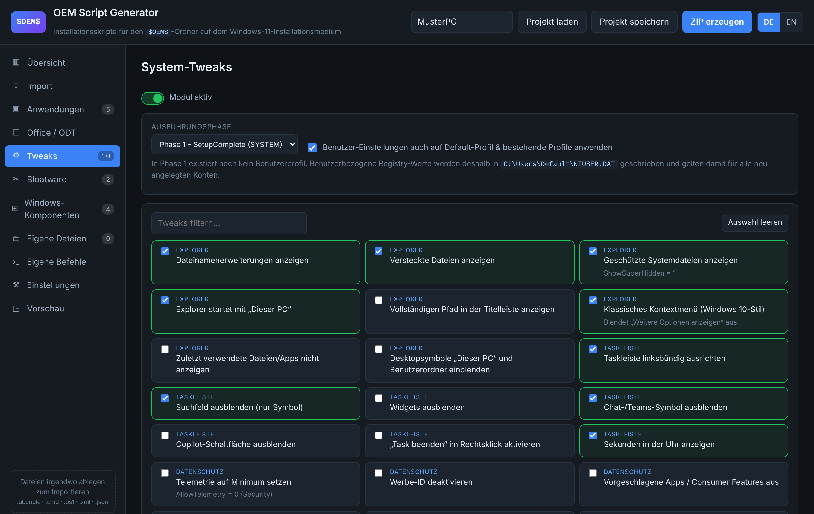
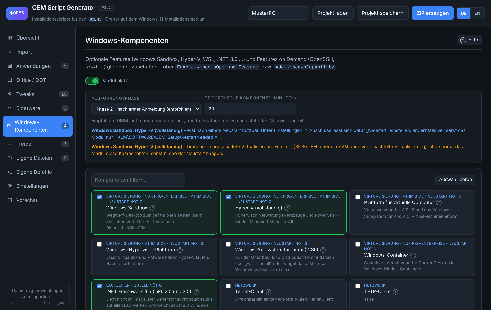
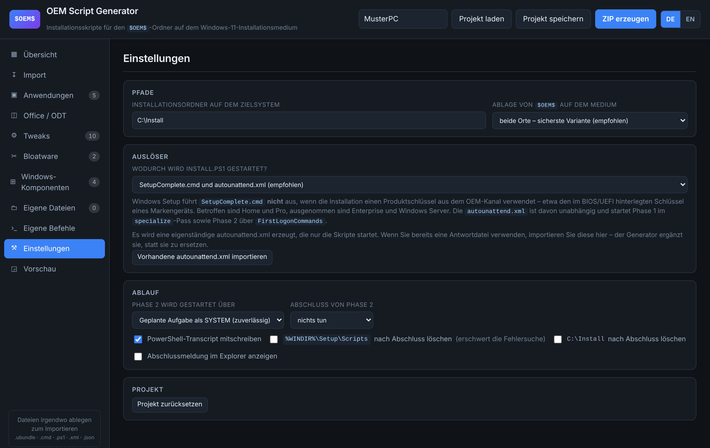
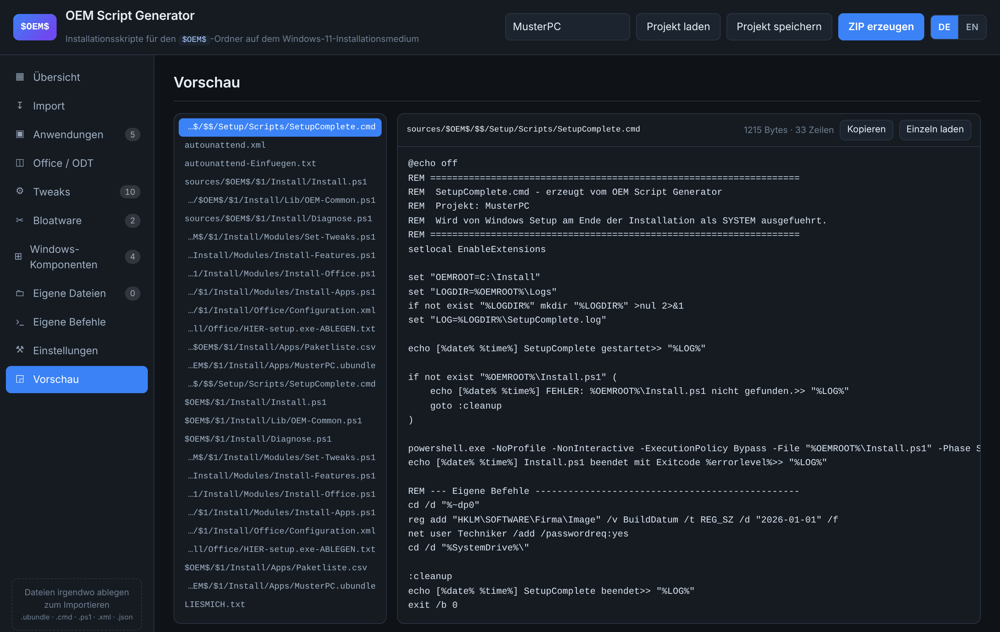
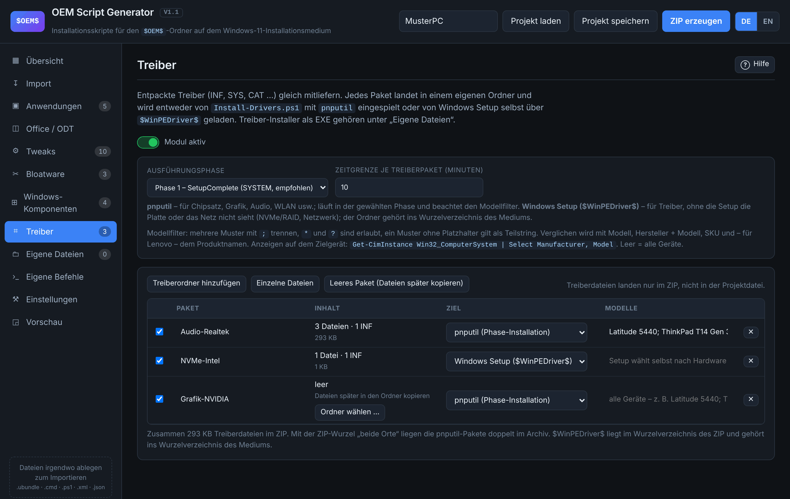
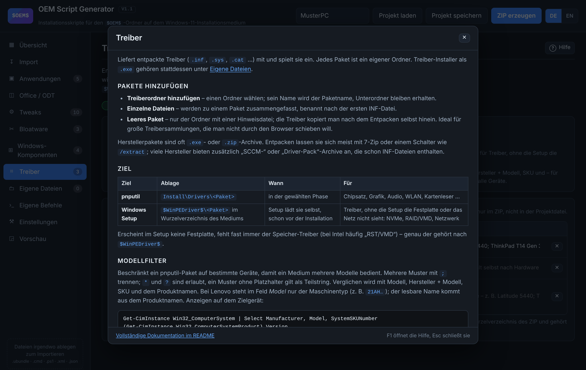

# OEM Script Generator

*Deutsche Fassung · [English version](README.en.md)*

Web-Oberfläche zum Erzeugen von Installationsskripten für den `$OEM$`-Ordner eines
Windows-11-Installationsmediums. Konfiguration im Browser, Ergebnis ist ein ZIP mit
der fertigen Ordnerstruktur, die direkt in die ISO bzw. auf den USB-Stick kopiert wird.

Läuft vollständig lokal: keine Server-Komponente, keine externen Bibliotheken, kein
Build-Schritt. `index.html` im Browser öffnen genügt (auch per `file://`).

Die Oberfläche ist zweisprachig – Deutsch und Englisch. Der Umschalter sitzt in der
Kopfzeile (**DE** / **EN**), beim ersten Start entscheidet die Browsersprache. Die
Sprache bestimmt auch, ob im erzeugten Archiv `LIESMICH.txt` oder `README.txt` liegt.

## Screenshots



| | |
|---|---|
|  |  |
| **Anwendungen** – Pakete aus Bundles und Skripten, je Paket mit Manager und Version | **Office / ODT** – Configuration.xml auswerten und prüfen |
|  |  |
| **Tweaks** – Einstellungen mit Phase und Netzwerkbedarf | **Windows-Komponenten** – mit Hilfe-Link und Virtualisierungsprüfung |
|  |  |
| **Einstellungen** – Auslöser, Phase 2, Abschluss | **Vorschau** – jede erzeugte Datei vor dem Export |
|  |  |
| **Treiber** – Pakete für pnputil oder Windows Setup, mit Modellfilter | **Hilfe** – ausführliche Beschreibung zu jeder Seite, auch per F1 |

## Download

Das fertige Paket liegt unter [Releases](https://github.com/dmatrix68-boop/OEM-script-gen/releases):
ZIP entpacken, `index.html` öffnen. Im Paket sind die Screenshots nur verlinkt.

## Funktionen

* **Import bestehender Skripte** – `SetupComplete.cmd`/`.bat` wird analysiert:
  `winget install`-Aufrufe werden zu Paketen, ODT-Aufrufe erkannt, alles Übrige
  bleibt als „eigene Befehle“ unverändert erhalten. Ebenfalls importierbar:
  ODT-`Configuration.xml`, PowerShell-Skripte, beliebige Binärdateien.
* **UniGetUI-Import** – `.ubundle` (JSON, XML, YAML) und winget-`export`-Dateien.
  Nicht-winget-Manager (Chocolatey, Scoop, npm, pip, Cargo, .NET Tool) werden
  übernommen und passend installiert; Chocolatey wird bei Bedarf nachinstalliert.
  Beim Export entsteht wieder ein `.ubundle`, das UniGetUI einlesen kann.
  Die Paketliste lässt sich per Klick auf den Spaltenkopf sortieren; die
  Installationsreihenfolge bleibt davon unberührt.
* **Microsoft Office (ODT)** – Configuration.xml importieren oder bearbeiten, mit
  Auswertung (Produkte, Sprachen, Kanal) und Prüfung auf unbeaufsichtigte
  Installation. Läuft standardmäßig in Phase 2, weil das Deployment Tool die
  Installationsdateien aus dem Netz lädt.
* **System-Tweaks** – rund 35 Einstellungen zu Explorer, Taskleiste, Datenschutz,
  System und Netzwerk. Benutzerbezogene Werte werden in Phase 1 in
  `C:\Users\Default\NTUSER.DAT` geschrieben und gelten damit für neue Konten.
  Einstellungen, die einen laufenden Netzwerk- oder Dienststack brauchen, werden
  automatisch in Phase 2 nachgeholt (siehe unten).
* **Registry-Dateien** – `.reg`-Exporte (REGEDIT4 und 5.00, UTF-16) werden Wert für
  Wert übernommen und laufen mit den Tweaks. `HKCU` landet im Default-Profil bzw. bei
  allen Benutzern statt – wie bei `reg import` als SYSTEM – im Profil von SYSTEM;
  `HKCR` wird zu `HKLM\SOFTWARE\Classes`, `HKEY_USERS` wird übersprungen.
* **Bloatware** – Auswahl vorinstallierter AppX-Pakete inkl. Provisioning-Entfernung.
* **Windows-Komponenten** – Windows Sandbox, Hyper-V, WSL, .NET 3.5, OpenSSH, RSAT und
  weitere Features gleich mit zuschalten (siehe unten).
* **Treiber** – entpackte Treiber per `pnputil` einspielen oder über `$WinPEDriver$`
  schon in Windows Setup laden, optional je Gerätemodell (siehe unten).
* **Eigene Dateien** – Installer und Skripte mitliefern, wahlweise nach
  `Install\Files` (wird ausgeführt) oder neben `SetupComplete.cmd` in
  `Setup\Scripts` (über `%~dp0` erreichbar). Bekannte Setup-Dateien bekommen ihre
  Parameter aus einem Vorlagen-Katalog (`Catalog.INSTALLERS`, z. B. Right-Click Tools);
  bei anderen `.exe` erkennt der Generator Inno Setup, NSIS und WiX Burn am Dateianfang
  und schlägt die Standardschalter vor. Ein Installer ohne Parameter wird nur kopiert –
  darauf weist die Tabelle hin.
* **autounattend.xml** – wird als Auslöser erzeugt oder, wenn Sie bereits eine
  Antwortdatei verwenden, importiert und **ergänzt statt ersetzt**: die Aufrufe
  werden mit fortlaufender `<Order>` in die vorhandenen Blöcke eingefügt.
* **Antwortdatei-Designer** – erzeugt eine vollständige `autounattend.xml` (Sprache,
  Konten, Computername, Edition, OOBE) als Portierung des Generators von Christoph
  Schneegans; der Generator fügt seine Aufrufe ein (siehe unten).
* **Diagnose.ps1** – liegt im erzeugten Paket und beantwortet nach der
  Installation, warum nichts gelaufen ist.
* **Hilfe auf jeder Seite** – der Knopf *Hilfe* im Seitenkopf (oder <kbd>F1</kbd>)
  öffnet eine ausführliche Beschreibung aller Optionen der Seite, auf Deutsch
  oder Englisch, mit Querverweisen zwischen den Themen.
* **Vorschau** aller erzeugten Dateien, **Projektdatei** zum Speichern und
  Weiterarbeiten, ZIP-Export (ab 4 GB automatisch ZIP64) oder (Chrome, Edge) **Export
  direkt in einen Ordner** bzw. auf den USB-Stick. Chrome und Edge fragen beim Speichern mit einem
  „Speichern unter“-Dialog nach dem Ziel; Firefox und Safari laden die Datei herunter.
* **ISO erzeugen** – Windows-ISO wählen, die erzeugten Dateien kommen hinzu, es entsteht
  eine neue, bootfähige ISO (BIOS und UEFI) – ohne oscdimg, ADK oder Adminrechte
  (siehe unten).

## Zwei-Phasen-Modell

| Phase | Auslöser | Kontext | Geeignet für |
|-------|----------|---------|--------------|
| 1 | `SetupComplete.cmd` am Ende des Setups | SYSTEM, vor der ersten Anmeldung | Registry, Bloatware, Office (ODT) |
| 2 | Geplante Aufgabe oder `RunOnce` bei der ersten Anmeldung | SYSTEM bzw. erster Benutzer | winget-Pakete, alles mit Netzwerkbedarf |

## Auslöser – warum `SetupComplete.cmd` allein nicht reicht

Windows Setup führt `SetupComplete.cmd` **nicht** aus, wenn die Installation einen
Produktschlüssel aus dem OEM-Kanal verwendet – etwa den im BIOS/UEFI hinterlegten
Schlüssel eines Markengeräts. Betroffen sind die Client-Editionen (Home, Pro);
Enterprise und Windows Server sind ausgenommen. Im Setup-Protokoll
`C:\Windows\Panther\setupact.log` steht dann sinngemäß:

```
Client OS edition and OEM license detected and no enterprise edition detected,
will not run SetupComplete.cmd
```

Der Generator bietet deshalb drei Auslöser an, standardmäßig beide gemeinsam:

| Auslöser | Phase 1 | Phase 2 | von der OEM-Sperre betroffen |
|---|---|---|---|
| `SetupComplete.cmd` | am Ende des Setups | geplante Aufgabe / RunOnce | **ja** |
| `autounattend.xml` | `specialize`-Pass | `FirstLogonCommands` | nein |

Mehrfachausführung ist unschädlich: `Install.ps1` vermerkt jede abgeschlossene
Phase unter `HKLM\SOFTWARE\OEM-Setup` und überspringt sie beim nächsten Aufruf;
`-Force` erzwingt die Wiederholung.

Gleichzeitige Läufe werden doppelt abgesichert. Ein benannter Mutex allein
genügt nicht: Legt ihn SYSTEM mit Standardrechten an, scheitert ein Lauf im
Benutzerkontext beim Öffnen an „Zugriff verweigert" und liefe ungebremst
parallel. Der Mutex wird deshalb mit einer Zugriffsregel für alle erstellt, und
zusätzlich hält `Install.ps1` eine Laufmarkierung mit Prozesskennung in der
Registry, die jeder Kontext lesen kann. Deckt die autounattend.xml Phase 2 schon
über `FirstLogonCommands` ab, startet die geplante Aufgabe erst 15 Minuten
verzögert — als Rückfall, nicht als zweiter gleichzeitiger Lauf.

### Warum manche Tweaks erst in Phase 2 laufen

Im `specialize`-Pass ist der Netzwerkstack noch nicht initialisiert. Cmdlets wie
`Get-NetConnectionProfile`, `Enable-NetFirewallRule` oder
`Disable-WindowsOptionalFeature` warten dort unter Umständen endlos — und weil
Windows Setup auf das Ende des Befehls wartet, **bleibt die gesamte Installation
stehen**. `-ErrorAction SilentlyContinue` hilft dagegen nicht: Es unterdrückt
Fehler, nicht das Blockieren.

Dieselbe Verschiebung gilt für Einstellungen, die ein angelegtes Benutzerkonto
brauchen — etwa „Anzeigename des Benutzerkontos berichtigen". Windows zeigt in
den Kontoeinstellungen den vollständigen Namen (`FullName`) und nur ersatzweise
den Kontonamen; kurz nach einer Installation steht dort mitunter ein Platzhalter
wie `USER`. **In aller Regel zieht Windows den richtigen Namen von selbst nach**,
der Tweak ist also kein Standardfall — er ist für Installationen gedacht, bei
denen der Platzhalter stehen bleibt. Er setzt `FullName` auf den Kontonamen, und
auch das nur dort, wo wirklich ein Platzhalter steht: selbstvergebene Namen,
deaktivierte Konten und Systemkonten bleiben unangetastet.

Betroffene Einträge sind im Katalog mit `deferPs` markiert (`deferReason`
unterscheidet Netzwerk- von Konto-Abhängigkeit). Steht das Tweak-Modul
auf Phase 1, erzeugt der Generator daraus ein zweites Modul
`Set-Tweaks-Spaet.ps1`, das in Phase 2 läuft; die Registry-Anteile desselben
Tweaks bleiben in Phase 1. Jeder dieser Aufrufe läuft zusätzlich über
`Invoke-WithTimeout` mit eigener Zeitgrenze, wird nach deren Ablauf abgebrochen
und protokolliert — ein hängendes Cmdlet kann den Ablauf also nicht mehr
blockieren.

Der Block läuft dabei in einem eigenen Runspace und kennt die Funktionen aus
`OEM-Common.ps1` nicht; `deferPs`-Tweaks dürfen deshalb nur native Cmdlets
verwenden.

## Wo gehört `$OEM$` hin?

Das hängt von der Antwortdatei ab – eine falsche Ablage ist die häufigste Ursache
dafür, dass gar nichts kopiert wird:

| Antwortdatei | Ablageort |
|---|---|
| `<UseConfigurationSet>true</UseConfigurationSet>` (setzt der Generator) | `<Medium>\$OEM$\…` (Wurzelverzeichnis) |
| keine Antwortdatei | `<Medium>\sources\$OEM$\…` |
| Antwortdatei mit `UseConfigurationSet=false` | bis 23H2 `<Medium>\sources\$OEM$\…`; ab 24H2 **gar nicht** kopiert |

Welcher Wert richtig ist, hängt vom Windows-Build ab:

| Zielsystem | `UseConfigurationSet` | Verhalten von Setup |
|---|---|---|
| Windows 11 24H2 und neuer | `true` | kopiert `$OEM$`; kein `ConfigSetRoot` |
| Windows 11 24H2 und neuer | `false` | kopiert `$OEM$` **gar nicht** – kein Installationsordner, keine Phase 2 (eigener Test mit Build 26300) |
| Windows 10, Windows 11 bis 23H2 | `false` | kopiert `sources\$OEM$` |
| Windows 10, Windows 11 bis 23H2 | `true` | kopiert `$OEM$`, aber zusätzlich **alles neben der Antwortdatei** nach `C:\Windows\ConfigSetRoot` – das ganze Medium, bei Ventoy die ganze Datenpartition |

Quelle für die älteren Builds ist die Diskussion im Projekt von Christoph Schneegans
([unattend-generator#474](https://github.com/cschneegans/unattend-generator/issues/474)),
der `true` aus diesem Grund nicht mehr fest setzt.

Der Generator fragt deshalb unter *Einstellungen → Auslöser* nach dem **Zielsystem**
und schreibt den passenden Wert in die erzeugte und in eine importierte Antwortdatei.
Eine importierte Datei mit `true` wird für „bis 23H2“ auf `false` gesetzt. Für ein
Medium, das beide Generationen installieren soll, gibt es „beide“: `true` mit
deutlichem Hinweis auf die Kopie. Beim Wählen einer Quell-ISO (*ISO erzeugen*) liest
der Generator den Build aus `install.wim`/`.esd` und stellt das Zielsystem passend
ein. Die Ablage „beide Orte“ bedient alle Fälle – Setup wertet nur den passenden Ordner
aus, der andere wird ignoriert.

### Office braucht ein Netzwerk

Das Office Deployment Tool lädt die Installationsdateien von Microsoft — auch
dann, wenn die `setup.exe` mitgeliefert wird; das Archiv enthält nur das
Werkzeug, nicht Office selbst. In Phase 1 (`specialize`) steht aber noch keine
Netzwerkverbindung zur Verfügung, genau wie bei den Netzwerk-Tweaks oben.

Das Office-Modul steht deshalb auf Phase 2. Ohne Netzwerk und ohne lokale Quelle
bricht es mit einer erklärenden Meldung ab, statt ins Leere zu laufen.

#### Offline-Installation aus mitgelieferter Quelle

Für Phase 1 — oder für Rechner ohne Internetzugang — stellt man die
Installationsquelle unter *Office → Installationsquelle* auf **lokal
mitgeliefert**. Der Generator trägt dann `SourcePath` in die
`Configuration.xml` ein und legt im Paket an:

```
Office/
├─ setup.exe                      (ODT, selbst ablegen)
├─ Configuration.xml              SourcePath=C:\Install\Office\Quelle
├─ Download-Quelle.ps1            erzeugt die Quelle
└─ Quelle/                        hierhin kommt Office\Data\…
```

Die Quelle selbst landet **nicht** im ZIP — mehrere Gigabyte durch den Browser
zu schleusen ist nicht praktikabel. Stattdessen führt man nach dem Entpacken auf
dem Vorbereitungsrechner einmal aus:

```powershell
powershell -ExecutionPolicy Bypass -File Office\Download-Quelle.ps1
```

Das Skript liest die `Configuration.xml`, lädt genau die darin konfigurierten
Produkte und Sprachen per `setup.exe /download` in den Quellordner und meldet
am Ende die belegte Größe. Danach kommt der gefüllte Ordner mit aufs Medium.

Der Exitcode des Deployment Tools allein entscheidet nicht: `Install-Office.ps1`
liest nach der Installation
`HKLM\SOFTWARE\Microsoft\Office\ClickToRun\Configuration` und bewertet einen
abweichenden Exitcode als Warnung, wenn Office danach vorhanden ist. Fehlt es,
bricht das Modul mit einer Ausnahme ab, damit die Zusammenfassung am Ende des
Laufs nicht trotzdem `OK` meldet.

`Install-Office.ps1` prüft zur Laufzeit, ob unter `SourcePath` tatsächlich
`Office\Data` liegt. Fehlt die Quelle — etwa weil sie nicht mitkopiert wurde —,
entfernt es `SourcePath` aus einer Arbeitskopie der Antwortdatei und installiert
online weiter, statt an einem leeren Ordner zu scheitern.

### Windows-Komponenten

Optionale Features (`Enable-WindowsOptionalFeature`) und Features on Demand
(`Add-WindowsCapability`) lassen sich mit zuschalten – Windows Sandbox, Hyper-V,
WSL, Container, .NET 3.5, Telnet, IIS, ProjFS, OpenSSH und die RSAT-Werkzeuge.
Das **?** neben jeder Komponente öffnet die passende Hilfeseite bei Microsoft –
auf Deutsch oder Englisch, je nach eingestellter Oberflächensprache.
Das Modul steht standardmäßig auf Phase 2 und prüft vor jedem Aufruf:

| Prüfung | Verhalten |
|---|---|
| bereits aktiv bzw. installiert | wird übersprungen, kein DISM-Aufruf |
| Edition (`EditionID` beginnt mit `Core`) | Sandbox, Hyper-V und Container entfallen auf Home |
| Virtualisierung (VT-x/AMD-V, Firmware, SLAT – auch in einer VM mit verschachtelter Virtualisierung; alternativ VBS bzw. Hyper-V schon aktiv) | Sandbox, Hyper-V, VM- und Hypervisor-Plattform werden ohne Virtualisierung übersprungen – sonst bliebe der Neustart hängen. Die Rohwerte stehen im Protokoll |
| Netzwerk | Features on Demand werden ohne Verbindung übersprungen |

Jeder Aufruf läuft über `Invoke-WithTimeout` mit eigener Zeitgrenze
(voreingestellt 20 Minuten) – ein hängendes DISM kann den Ablauf also nicht
blockieren. Das zählt doppelt, wenn das Modul doch in Phase 1 läuft: dort wartet
Windows Setup auf jeden Aufruf.

`.NET Framework 3.5` liegt nicht im installierten Image. Das Modul sucht
`sources\sxs` auf allen Laufwerken – liegt das Installationsmedium noch im
Rechner, wird daraus installiert, sonst über Windows Update. Features on Demand
(OpenSSH, RSAT) kommen immer von Windows Update; eine WSUS-Richtlinie ohne
Freigabe für Features on Demand lässt sie scheitern.

Komponenten, die einen Neustart brauchen, setzen
`HKLM\SOFTWARE\OEM-Setup\RestartNeeded = 1`. Mit *Einstellungen → Abschluss →
Neustart* erledigt sich das von selbst.

### Treiber

Entpackte Treiber (INF, SYS, CAT …) werden als Pakete mitgeliefert – je Paket ein
Ordner. Hinzufügen per **Treiberordner hinzufügen** (der Ordnername wird der
Paketname), als einzelne Dateien oder als **leeres Paket**, dessen Dateien man
später selbst auf das Medium kopiert. Leere Pakete eignen sich für große
Treibersammlungen, die man nicht durch den Browser schieben will.

| Ziel | Ablage | Wann | Geeignet für |
|---|---|---|---|
| **pnputil** | `$OEM$\$1\Install\Drivers\<Paket>` | in der gewählten Phase (Standard: Phase 1) | Chipsatz, Grafik, Audio, WLAN … |
| **Windows Setup** | `$WinPEDriver$\<Paket>` im Wurzelverzeichnis des Mediums | Setup lädt sie selbst, vor der Installation | NVMe/RAID, Netzwerk – alles, ohne das Setup nicht weiterkommt |

`Install-Drivers.ps1` ruft je Paket
`pnputil /add-driver <Paket>\*.inf /subdirs /install` auf, mit eigener
Zeitgrenze. Exitcode 3010 setzt `RestartNeeded`, 259 bedeutet „im
Treiberspeicher, aber kein Gerät hat ihn übernommen“ – beides gilt als Erfolg.

**Modellfilter:** Ein Paket lässt sich auf bestimmte Geräte beschränken, damit
ein Medium mehrere Modelle bedient. Mehrere Muster mit `;` trennen, `*` und `?`
sind erlaubt, ein Muster ohne Platzhalter gilt als Teilstring. Verglichen wird
mit Modell, Hersteller + Modell, SKU und – für Lenovo, wo `Model` nur den
Maschinentyp enthält – dem Produktnamen aus `Win32_ComputerSystemProduct`. Die
erkannten Werte stehen im Protokoll. Auf dem Zielgerät anzeigen:

```powershell
Get-CimInstance Win32_ComputerSystem | Select Manufacturer, Model, SystemSKUNumber
```

Treiberdateien landen nur im ZIP, nicht in der Projektdatei: Nach dem Laden
eines Projekts sind die Pakete wieder da, aber leer, mit dem Namen des Ordners,
aus dem sie zuletzt kamen. Automatisch einbinden lassen sie sich nicht – liest
eine Webseite einen gemerkten Ordner, lässt Chrome alle als gefährlich
eingestuften Dateitypen weg, also gerade die DLLs. Dateien unter *Eigene
Dateien* dagegen merkt sich Chrome/Edge und bindet sie beim Laden direkt wieder
ein; braucht Chrome dafür erneut die Freigabe, genügt ein Klick auf **Quellen
einbinden** (nur im selben Browserprofil). Mit der ZIP-Wurzel „beide
Orte“ liegen die pnputil-Pakete doppelt im Archiv. Treiber-Installer als EXE
gehören weiterhin unter *Eigene Dateien*.

### winget braucht einen Benutzerkontext

`winget.exe` ist Teil eines MSIX-Pakets. Erreichbar ist es über den
App-Execution-Alias unter `%LOCALAPPDATA%\Microsoft\WindowsApps\winget.exe` —
und den gibt es **nur je Benutzer**. Ruft man die Datei stattdessen direkt aus
`C:\Program Files\WindowsApps\…` auf, wie es unter SYSTEM naheliegt, bricht sie
mit `0xC0000135` (`-1073741515`, DLL nicht gefunden) ab, weil die
MSIX-Abhängigkeiten nicht aufgelöst werden.

Gemessen an einem Durchlauf mit 33 Paketen: als SYSTEM 3 erfolgreich, im
Benutzerkontext 33.

Welche winget-Exitcodes als Erfolg zählen, richtet sich nach
`AppInstallerErrors.h` aus winget-cli: neben `0` und den Neustart-Codes `3010`
und `1641` sind das `0x8A150061` (Paket bereits installiert) und `0x8A15002B`
(kein Upgrade anwendbar). `0x8A150014` steht für *kein Paket gefunden* und zählt
ausdrücklich **nicht** dazu — sonst gälte eine falsch geschriebene Paket-ID als
erfolgreich installiert. Zu den häufigsten Fehlercodes schreibt das Modul eine
Klartextzeile ins Protokoll.

Aus demselben Grund ruft `Install-Apps.ps1` die Paketmanager **direkt** auf
(`& $exe $args`) und nicht über `Start-Process`: Der Alias stößt den
eigentlichen Vorgang an und beendet sich sofort, `Start-Process`/`WaitForExit`
wartet also nur auf den Stub, liefert einen leeren Exitcode und meldet ein
gerade laufendes Paket als gescheitert. Die nötige Zeitgrenze kommt stattdessen
daher, dass der Aufruf in einem Hintergrundauftrag läuft — dort bleibt
`$LASTEXITCODE` erhalten. Für Anwendungen muss Phase 2 deshalb im Benutzerkontext
laufen — über `FirstLogonCommands` der autounattend.xml oder über `RunOnce`.
`Resolve-Winget` prüft jeden Kandidaten vorab mit `--version` und bricht mit
einer erklärenden Meldung ab, statt jedes Paket einzeln scheitern zu lassen.

Hintergrund zu den Phasen: In Phase 1 ist `winget` nur eingeschränkt nutzbar – der App Installer ist
ein MSIX-Paket, das unter SYSTEM nicht im Suchpfad liegt (der Generator löst den Pfad
unter `Program Files\WindowsApps` selbst auf), und Pakete, die ausschließlich
benutzerbezogen installieren, schlagen ohne Benutzerprofil fehl. Deshalb ist für
Anwendungen standardmäßig Phase 2 vorgewählt.

## Antwortdatei-Designer

Die Seite **Antwortdatei** erzeugt eine vollständige `autounattend.xml`: Sprache des
Images, bis zu drei Gebietsschemas mit Tastatur, Standort, Zeitzone, Edition bzw.
Produktschlüssel, Hardwareprüfung umgehen, Einrichtung ohne Internet, Computername (fest
oder bei der Installation abgefragt), lokale Konten mit automatischer Anmeldung,
Datenschutz- und WLAN-Seite, Kontosperrung und Kennwortablauf. Der Generator fügt danach –
wie bei einer importierten Datei – seine Aufrufe ein und setzt `UseConfigurationSet` nach
dem Zielsystem.

Der Designer ist eine **Portierung** des Generators von Christoph Schneegans
([unattend-generator](https://github.com/cschneegans/unattend-generator), MIT-Lizenz,
Lizenztext unter `vendor/schneegans/LICENSE.txt`). Die Logik ist Datei für Datei nach
JavaScript übertragen (`js/ug/core.js`, `js/ug/modifiers.js`, je Modifier ein Abschnitt
gleichen Namens), die Datentabellen und Skripte des Originals werden unverändert übernommen
(`js/ug/resources.js`, erzeugt). Abweichungen sind im Code mit `PORT:` markiert.

Mit **Installation & Partitionierung → pe.cmd** übernimmt ein Skript die windowsPE-Phase:
Zieldatenträger bestimmen (nach Kriterien, fest, abgefragt oder per VBScript), mit `diskpart`
einteilen (GPT/MBR nach Firmware, Wiederherstellungspartition, oder eigenes Skript), Image per
`dism` aufspielen, `bcdboot`, Treiber aus `$WinPEDriver$`, `$OEM$` aus dem Wurzelverzeichnis per
`robocopy` kopieren, neu starten. **Die automatische Partitionierung löscht den Zieldatenträger
ohne Rückfrage**; ist der Datenträger nicht eindeutig, hält Setup an.

Unter **Personalisierung** stehen Farben (Design, Akzentfarbe, Transparenz), Sperrtasten
(Zustand beim Start, Taste ignorieren), visuelle Effekte, Desktopsymbole, „Edge-Verknüpfung
löschen“ und die Ordner im Startmenü. Sie greifen für jedes neue Konto bei der ersten
Anmeldung – auch ohne Aktivierung. Überschneidungen mit Tweaks (Dunkles Design,
Desktopsymbole, NumLock) besser nur an einer Stelle wählen.

**AppLocker** übernimmt eine Richtlinie als XML (Export von `Get-AppLockerPolicy -Local -Xml`
oder aus `secpol.msc`; auch per Drag & Drop, UTF-16 inklusive), prüft sie gegen das Schema
`AppLocker.xsd` des Originals und wendet sie im `specialize`-Pass mit `Set-AppLockerPolicy` an.
Die Schemaprüfung ist im Port nachgebaut, weil der Browser kein XSD kennt; ihre Meldungen
lauten deshalb anders als beim Original, der Golden-Test vergleicht dort nur das Präfix.

**WLAN** verbindet mit Netzwerkname, Kennwort und Sicherheit (WPA2, WPA3, offen, auch verborgen)
oder übernimmt ein Profil aus `netsh wlan export profile key=clear` (geprüft gegen
`WLAN_profile_v1.xsd`, ebenfalls nachgebaut). Das Kennwort steht im Klartext in der Antwortdatei.

**Hintergrundbild und Sperrbildschirm** nehmen eine Farbe, ein hochgeladenes Bild (Base64 in der
Antwortdatei) oder ein eigenes PowerShell-Skript, das die Bilddaten liefert. **Gasterweiterungen**
für VirtualBox, VMware, VirtIO (QEMU/KVM, Proxmox) und Parallels werden installiert, wenn das
Medium in der VM eingelegt ist; mit `pe.cmd` lädt VirtIO zusätzlich Speicher- und Netzwerktreiber.

Damit sind alle Modifier des Originals portiert – bis auf Bloatware und die übrigen Optimierungen,
für die der Generator eigene Kataloge hat (Seiten *Bloatware* und *Tweaks*).
Tweaks und Bloatware liefert der Generator selbst.

### Änderungen im Original beobachten

`vendor/schneegans/UPSTREAM.json` hält fest, auf welchem Commit der Port beruht, je Datei
die Git-Blob-Kennung, das Ziel im Port und den Stand der Portierung. Der Workflow
*Schneegans beobachten* klont das Original wöchentlich, vergleicht und legt bei Änderungen
ein Issue an – mit den neuen Commits, den betroffenen Dateien samt Ziel-Modul, einem
Diff-Link und geänderten Skripten im Wortlaut (sie laufen auf den Zielrechnern als
SYSTEM). Übernommen wird nichts automatisch. Nach Durchsicht und Portierung:

```bash
git clone https://github.com/cschneegans/unattend-generator.git ../unattend-generator
node tools/sync-schneegans.js ../unattend-generator --resources --write
```

`--resources` erzeugt `js/ug/resources.js` neu, `--write` setzt den Port-Stand. Ohne diese
Schalter zeigt das Werkzeug nur den Bericht.

### Golden-Test gegen das Original

Ob der Port dasselbe liefert wie das Original, prüft `tools/test-golden.js`: Für jeden Fall
aus `tools/golden/cases.json` erzeugt der Port in Chromium die Antwortdatei, ein kleines
C#-Programm (`tools/golden`) bindet die **unveränderten** Quellen des Originals ein,
übersetzt dieselbe Konfiguration in dessen `Configuration` und erzeugt dessen Ergebnis.
Verglichen wird Byte für Byte (ausgeblendet nur `<Build>` mit dem jeweiligen Commit-Hash),
bei Fehlerfällen auch die Meldung. Der Workflow *Tests* vergleicht gegen den Port-Stand, der
Workflow *Schneegans beobachten* bei Änderungen gegen den neuesten Stand und schreibt das
Ergebnis ins Issue. Lokal (braucht .NET 8 und Playwright; führt den Code des Originals aus):

```bash
node tools/test-golden.js --upstream ../unattend-generator
```

## Erzeugte Struktur

```
autounattend.xml                            → Wurzelverzeichnis des Mediums
sources/$OEM$/  bzw.  $OEM$/
├── $$/Setup/Scripts/SetupComplete.cmd     → %WINDIR%\Setup\Scripts
└── $1/Install/                            → C:\Install
    ├── Install.ps1                        Steuerskript (-Phase Setup|FirstLogon|Manual)
    ├── Diagnose.ps1                       Fehlersuche nach der Installation
    ├── Lib/OEM-Common.ps1                 Logging, Registry-Helfer, winget-Auflösung
    ├── Modules/                            Set-Tweaks, Remove-Bloatware,
    │                                       Install-Features, Install-Office,
    │                                       Install-Apps, Install-Files-P1/P2,
    │                                       Invoke-Custom
    ├── Office/Configuration.xml
    ├── Apps/  Paketliste.csv, packages.json, *.ubundle
    └── Logs/                              Protokolle und Transcripts
```

## Verwendung

1. `index.html` öffnen (Chrome, Edge oder Firefox).
2. Bestehende Skripte bzw. das UniGetUI-Bundle per Drag & Drop ablegen.
3. Module konfigurieren, Vorschau prüfen, **ZIP erzeugen**.
4. Inhalt des ZIPs in das Wurzelverzeichnis des Installationsmediums kopieren, sodass
   `<Medium>\sources\$OEM$\...` entsteht. Der im ZIP enthaltene `LIESMICH.txt` listet
   auf, was noch fehlt (z. B. `setup.exe` des Office Deployment Tools).

Statt 3. und 4. geht in Chrome und Edge auch **In Ordner exportieren**: Wurzelverzeichnis
des USB-Sticks wählen, fertig – das Entpacken entfällt, Installer und Treiber werden
als Datenstrom von der Platte kopiert. Vorhandene Ordner `$OEM$`, `sources\$OEM$` und
`$WinPEDriver$` im Ziel werden nach Rückfrage vorher geleert – sonst blieben etwa
entfernte Treiber liegen. Alles andere auf dem Stick bleibt unberührt; eine vorhandene,
nicht importierte `autounattend.xml` würde ersetzt, darauf weist die Rückfrage hin.
Dateitypen, die Chrome nicht in Ordner schreibt (vor allem `.dll`, dazu `.ini`, `.cfg`,
`.manifest`), landen als `*.oemrename` auf dem Stick;
`Install.ps1` benennt sie vor dem ersten Modul zurück. Für Treiber unter
`$WinPEDriver$` geht das nicht – dafür das ZIP verwenden.

### ISO erzeugen

Wer das Medium ohnehin als ISO braucht – für VMs, Ventoy oder Rufus –, spart sich mit
**ISO erzeugen** das Entpacken und das Neuschreiben mit oscdimg, AnyBurn & Co.:

1. **ISO erzeugen** klicken (oder vorab *Einstellungen → ISO-Abbild → Quell-ISO wählen*)
   und die Original-ISO von Microsoft wählen. Die Übersicht zeigt Bezeichnung, Abbild,
   Booteinträge und was ersetzt wird.
2. Ziel wählen – fertig. Chrome und Edge fragen per „Speichern unter“ und zeigen den
   Fortschritt im Knopf; Firefox lädt herunter.

Die neue ISO enthält den gesamten Inhalt der Quelle plus `autounattend.xml`, `$OEM$`,
`$WinPEDriver$`, `LIESMICH.txt` und die Projektdatei. Vorhandene Ordner `$OEM$`,
`sources\$OEM$` und `$WinPEDriver$` der Quelle werden ersetzt. Bringt die Quelle eine
eigene `autounattend.xml` mit und ist keine importiert, fragt der Generator einmal, ob sie
übernommen und ergänzt oder ersetzt wird. `install.wim`/`install.esd` und `boot.wim`
bleiben unverändert. Anders als beim Ordner-Export kommen `.dll`-Dateien unter ihrem
Namen an – auch unter `$WinPEDriver$`.

Aufbau wie bei Microsoft (`oscdimg -u2 -udfver102`): UDF 1.02 mit dem gesamten Inhalt,
ISO 9660 nur als Hülle mit einer `README.TXT`, El-Torito-Bootkatalog mit den Einträgen der
Quelle (BIOS `etfsboot.com`, UEFI `efisys.bin`). Dateien über 4 GB liegen in mehreren
Extents; jede Datei beginnt auf einer 4-KB-Grenze. Die Quell-ISO wird nicht in den
Speicher geladen – ihre Dateien gehen als Ausschnitt der Datei direkt ins Ergebnis.

*Ohne „Press any key“ starten* (Einstellungen) nimmt `efisys_noprompt.bin` und lässt
`boot\bootfix.bin` weg. Praktisch für VMs, aber Vorsicht: Bleibt die ISO eingelegt,
beginnt die Installation nach jedem Neustart von vorn.

Nicht unterstützt sind ISOs von Brennprogrammen mit UDF 2.x (Metadaten-Partition) oder
Festplatten-Emulation im Bootkatalog – dafür die Original-ISO verwenden. Eine ISO über
4 GB passt nicht auf ein FAT32-Laufwerk.

Große Pakete passen auch ins ZIP: Ab 4 GB oder 65.535 Dateien schreibt der Generator
automatisch **ZIP64**, das der Windows-Explorer ab Windows 10 und 7-Zip entpacken.
Dateien über 128 MB kommen unkomprimiert hinein – Treiber und Installer sind meist
schon gepackt –, dafür liest der Browser sie direkt von der Platte, statt sie im
Arbeitsspeicher zu sammeln (getestet: 5,2-GB-Archiv mit unter 90 MB Speicherbedarf).

### Die Installation muss vom Medium gebootet werden

`$OEM$` und `autounattend.xml` wertet Windows Setup nur aus, wenn vom
Installationsmedium **gebootet** wird. Startet man `setup.exe` aus einem
laufenden Windows heraus, läuft Setup in der Downlevel-Phase (Arbeitsordner
`C:\$WINDOWS.~BT`) und ignoriert beides. Die Setup-Protokolle dieser Phase liegen
unter `C:\$WINDOWS.~BT\Sources\Panther\` – `Diagnose.ps1` durchsucht sie mit.

### Wenn nichts passiert ist

Auf dem installierten System in einer administrativen PowerShell:

```powershell
powershell -ExecutionPolicy Bypass -File C:\Install\Diagnose.ps1
```

Liegt das Paket woanders — etwa noch auf dem Medium —, findet das Skript seinen
eigenen Ordner selbst; mit `-InstallRoot <Pfad>` lässt sich er auch vorgeben.

Das Skript prüft Dateien, Ausführungsmarker, geplante Aufgabe und Protokolle,
wertet `setupact.log` aus und meldet ausdrücklich, wenn Setup `SetupComplete.cmd`
wegen des OEM-Lizenzkanals verweigert hat oder wenn `$OEM$` am falschen Ort lag.

Mit `-Export` packt es die relevanten Stellen in ein ZIP von typischerweise
wenigen Kilobyte – die passenden Zeilen aus allen `setupact.log`-Fundorten, die
eigenen Protokolle und den Systemzustand. Das ist das, was man zum Weitergeben
braucht; ganze Setup-Ordner sind dafür nicht nötig:

```powershell
powershell -ExecutionPolicy Bypass -File C:\Install\Diagnose.ps1 -Export
```

### Test ohne Neuinstallation

Auf einem Testsystem in einer administrativen PowerShell:

```powershell
powershell -ExecutionPolicy Bypass -File C:\Install\Install.ps1 -Phase Manual
powershell -ExecutionPolicy Bypass -File C:\Install\Install.ps1 -Phase Manual -Only Set-Tweaks.ps1
```

## Hinweise

* Die erzeugten `.ps1`-Dateien werden mit UTF-8-BOM geschrieben, damit Windows
  PowerShell 5.1 Umlaute korrekt liest.
* `$OEM$` wird nur ausgewertet, wenn das Setup von diesem Medium gestartet wird.
* Läuft Phase 1 über den `specialize`-Pass, verzögert jedes Modul das Setup, weil
  Windows auf das Ende des Befehls wartet. Langläufer wie die Office-Installation
  gehören deshalb besser in Phase 2.
* Beim Speichern eines Projekts werden mitgelieferte Binärdateien **nicht** in die
  Projektdatei aufgenommen – sie müssen nach dem Laden erneut hinzugefügt werden.
* Die erzeugten PowerShell-Skripte und ihre Protokollausgaben sind unabhängig von
  der Oberflächensprache deutsch; nur die Dokumentation im Archiv folgt dem
  Umschalter.

## Entwicklung

Die PowerShell-Skripte entstehen in JavaScript-Template-Literalen. Dort
verschluckt JavaScript Backslash-Folgen, die es nicht als Escape kennt: aus
`'\s+'` wird `'s+'`, aus `'\|'` wird `'|'` — der erzeugte Code enthält dann
stillschweigend ein anderes Muster. So entstand unter anderem ein `-split`, das
nie etwas trennte, und ein `-replace`, das jedes „s" durch ein Leerzeichen
ersetzte. Im Template-Literal gehören solche Folgen deshalb verdoppelt
(`\\s+`). Dagegen prüft:

```bash
node tools/check-escapes.js
```

Zweisprachigkeit: Oberflächentexte tragen `data-i18n`, Katalog- und
Laufzeittexte laufen über `T()`/`F()` mit der deutschen Fassung als Schlüssel.
Ein übersetzter Bereich darf kein Element mit `id` enthalten – `I18n.apply()`
schreibt seinen Inhalt komplett neu und würde dort gesetzte Zähler oder Pfade
überbügeln. Dagegen prüft:

```bash
node tools/check-i18n.js
```

Der Antwortdatei-Designer (`js/ug`) braucht DOM und XPath; sein Test läuft deshalb in
Chromium und setzt Playwright voraus (ohne Playwright meldet er „übersprungen“):

```bash
node tools/test-unattend.js
```

Die erzeugten PowerShell-Skripte prüft der Workflow *Tests* bei jedem Push und Pull
Request auf einem Windows-Runner: Syntax und PSScriptAnalyzer unter Windows PowerShell 5.1
und PowerShell 7, dazu Funktionstests unter 5.1 – das Tweak-Modul schreibt die Werte aus
`samples/Beispiel.reg` wirklich in die Registry (auch ins Default-Profil) und liest sie
zurück, `Diagnose.ps1` muss durchlaufen. Lokal (nur auf einem Wegwerf-System, die Tweaks
ändern das System):

```bash
node tools/emit-scripts.js out
```

```bash
powershell -ExecutionPolicy Bypass -File tools/test-powershell.ps1 -Root out -Functional
```

Der ISO-Schreiber (`js/iso.js`) lässt sich ohne Browser prüfen: Das Testwerkzeug baut
eine synthetische Windows-ISO, liest sie zurück, schreibt sie wie die Oberfläche neu
und vergleicht – mit `udfinfo` und 7-Zip, sofern installiert, auch gegen unabhängige
UDF-Implementierungen:

```bash
node tools/test-iso.js
```

Prozesse werden über `ProcessStartInfo` gestartet, nicht über
`Start-Process -PassThru`: dessen Prozessobjekt liefert nach `WaitForExit()`
einen leeren `ExitCode`, weil PowerShell das Handle nicht offen hält. Das
Office Deployment Tool wurde dadurch trotz erfolgreicher Installation als
Fehler gemeldet. Die Ausgabe wird asynchron gelesen – wer erst wartet und dann
liest, hängt, sobald das Programm mehr schreibt, als in den Puffer passt.

## Projektaufbau

```
index.html        Oberfläche
css/app.css       Layout
js/version.js     Versionsnummer (einzige Stelle)
js/help.js        Hilfetexte je Seite (Deutsch/Englisch)
js/i18n.js        Wörterbuch Deutsch/Englisch und Sprachumschaltung
js/zip.js         ZIP-Writer (Deflate über CompressionStream, sonst „stored“)
js/iso.js         ISO lesen und neu schreiben (UDF 1.02, El Torito)
js/ug/            Antwortdatei-Designer (Port des Schneegans-Generators):
                  core.js, modifiers.js, resources.js (erzeugt)
vendor/schneegans/ Lizenz und Port-Stand (UPSTREAM.json) des Originals
js/catalog.js     Katalog für Tweaks, Bloatware und Windows-Komponenten, Paketmanager
js/importers.js   Parser für Bundles, SetupComplete.cmd und ODT-XML
js/templates.js   Erzeugung sämtlicher Skripte
js/app.js         Zustand, Oberfläche, Import/Export
samples/          Beispieldateien zum Testen der Importfunktion
tools/            check-escapes.js – prüft die Template-Literale auf verschluckte Escapes
                  check-i18n.js    – prüft Wörterbuch gegen Oberfläche
                  test-iso.js      – prüft den ISO-Schreiber
                  test-reg.js      – prüft den .reg-Import
                  test-unattend.js – prüft den Antwortdatei-Designer (Playwright)
                  sync-schneegans.js – Abgleich mit dem Original, erzeugt resources.js
                  test-golden.js   – Port gegen das C#-Original (golden/: Harness, Fälle)
                  emit-scripts.js  – erzeugt die Skripte mehrerer Testprofile ohne Browser
                  test-powershell.ps1 – prüft sie unter Windows (Syntax, PSScriptAnalyzer,
                                     Registry-Funktionstest, Diagnose.ps1)
                  build-release.js – schnürt das Release-Paket
docs/screenshots/ Bilder für das README (nicht im Release-Paket)
docs/releases/    Release-Notes je Version
```

### Release erstellen

Ein Tag `v*` startet den Workflow `.github/workflows/release.yml`. Er führt die
beiden Prüfungen aus, baut mit `node tools/build-release.js <tag>` das Paket
`dist/OEM-Script-Generator-<tag>.zip` und legt das GitHub-Release an. Die
Release-Notes kommen aus `docs/releases/<tag>.md`. Im Paket ersetzt das Skript
die eingebetteten Screenshots in beiden READMEs durch Links auf das Repository
zum selben Tag. Vorher die Versionsnummer in `js/version.js` anpassen – das
Build-Skript bricht ab, wenn sie nicht zum Tag passt.

```bash
git tag v2.0 && git push origin v2.0
```
